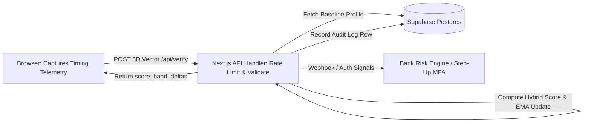

# 🛡️ Finomaly — Behavioral Biometrics & Mule Account Detection Layer

> **The Future Is Safe.** Passwords can be stolen. The way you move cannot be easily copied.

Finomaly is an advanced, privacy-first continuous authentication prototype engineered to detect **mule accounts, account takeovers, and unauthorized operators** in real-time through behavioral biometrics.

---

## 📌 The Problem: The Identity Gap in Financial Security

Traditional banking security relies heavily on static credentials (passwords, PINs) and 2FA (SMS OTPs, authenticator apps). 

In **mule account fraud** and **account takeover schemes**:
* Fraudsters routinely possess correct passwords and valid OTPs (purchased or coerced).
* Traditional authentication passes the imposter because credentials check out at login.

**Finomaly asks a better question:** *Does the person behind the keyboard still move and type like the legitimate account owner?*

---

## ✨ Key Features

* **🧠 5D Telemetry Vector Extraction**:
  Measures five distinct neuromuscular habits:
  1. *Average Keystroke Hold Time* (Dwell Time in ms)
  2. *Average Flight Time* (Gap between keypresses in ms)
  3. *Typing Speed* (Words Per Minute / WPM)
  4. *Hold Time Variance* (Consistency of key holds)
  5. *Flight Time Variance* (Rhythm consistency)

* **🔄 3-Session Baseline Enrollment**:
  Captures a multi-session baseline profile (`S1`, `S2`, `S3`) to construct a highly accurate behavioral centroid.

* **⚙️ Hybrid Similarity Engine (`biometrics.ts`)**:
  Combines **Weighted Cosine Similarity** with a **Euclidean Distance Penalty**. Large behavioral gaps (e.g. WPM differences or hold time anomalies) meaningfully drop the similarity score.

* **🚫 Zero-Telemetry & Bot Interceptor**:
  Instantly flags automated scripts, synthetic key injectors, zero-variance robotic typing (0ms hold times), and copy-paste events.

* **🔒 Privacy by Design (Ephemeral Timing Telemetry)**:
  Only a numeric timing vector is sent to the server, never what you type. Closing the session erases it. No raw keystroke content or financial data ever leaves the user's device.

---

## 🛠️ Tech Stack

### **Frontend & Framework**
* **Next.js 14** (App Router architecture)
* **React 18** (Client & Server Components)
* **TypeScript 5** (Strict type safety)

### **Backend & Database**
* **Next.js Route Handlers** (Node.js runtime server APIs: `/api/enroll`, `/api/verify`, `/api/audit`)
* **Supabase Postgres** (`@supabase/supabase-js`, server-side service role client)
* **Security & Guardrails**: In-memory IP rate limiting, `x-api-key` validation, input bounds validation, 3s client timeout with silent local fallback

### **Design, Styling & Motion**
* **Framer Motion 11** (Fluid UI transitions and HUD overlays)
* **CSS Modules & Custom Utility Variables** (Cyberpunk dark theme `#080c0d`, cyan neon `#00f5d4`)
* **HTML5 Canvas & Web Audio API** (Procedural sound synthesizer and 3D warp tunnel animation)

### **Analytics & Data Science**
* **Python 3** (`generate_report_pdf.py` / `generate_clean_pdf.py`)
* **Pandas / NumPy / ReportLab**: Data processing for the **1,000-Experiment Biometric Benchmark Report**.

---

## 🏛️ Architecture



```text
[ Browser captures timing ] ──(POST /api/verify)──> [ Next.js API Handler ] ──> [ Supabase Postgres ]
                                                              │                          │
                                                     (Hybrid Score & EMA)          (Audit Logs)
                                                              │                          │
                                                              ▼                          ▼
                                                    [ Return Score & Band ] ──> [ Bank Risk Engine ]
```

* **Privacy Isolation**: The browser only emits 5 anonymized timing metrics (Hold Time, Flight Time, WPM, Hold Variance, Flight Variance). Raw keystrokes and sensitive text are never transferred or stored.
* **Resilient Dual-Mode Verification**: Requests feature a 3-second timeout. If the database or network drops, the client transparently falls back to local mathematical verification (`"Local mode"` badge), ensuring zero downtime for end users.

---

## 📁 Project Structure

```text
finomaly/
├── app/
│   ├── api/
│   │   ├── enroll/route.ts          # POST /api/enroll (Centroid 3-session profile)
│   │   ├── verify/route.ts          # POST /api/verify (Hybrid score, EMA baseline update, audit logging)
│   │   └── audit/route.ts           # GET /api/audit (Recent 20 verification rows)
│   ├── audit/
│   │   └── page.tsx                 # Real-time audit dashboard UI
│   ├── demo/
│   │   ├── BaselineSession.tsx      # 3-Session baseline enrollment component
│   │   ├── LoginSession.tsx         # Live authentication verification test
│   │   ├── ResultsView.tsx          # Match score, radar charts, deltas & verification badge
│   │   ├── biometrics.ts            # Hybrid similarity engine & 5D vector normalization
│   │   ├── HowItWorksAnimation.tsx  # Interactive 3D visual walkthrough
│   │   └── DemoModal.tsx            # Main interactive demo modal
│   ├── globals.css                  # Custom styling & theme variables
│   ├── layout.tsx                   # Main layout container
│   └── page.tsx                     # Landing page
├── lib/
│   ├── apiClient.ts                 # Resilient API client with 3s timeout & fallback
│   ├── apiSecurity.ts               # In-memory IP rate limiting & API key verification
│   └── supabase.ts                  # Server-only Supabase service-role client
├── supabase/
│   └── schema.sql                   # SQL schema for profiles & audit_logs tables
├── .env.example                     # Environment variables template
├── public/
│   └── Finomaly_Biometric_1000_Experiment_Report.pdf
├── package.json
└── tsconfig.json
```

---

## ⚙️ Backend & Supabase Setup

### 1. Database Setup
1. Create a free project at [Supabase](https://supabase.com).
2. Go to the **SQL Editor** in the Supabase Dashboard.
3. Paste and run the contents of [`supabase/schema.sql`](./supabase/schema.sql). This provisions:
   - `profiles`: user enrollment baselines (JSONB), session counts, and user consent.
   - `audit_logs`: timestamped verification scores, bands, flags, and feature snapshots.

### 2. Configure Environment Variables
Copy `.env.example` to `.env.local` for local development:
```bash
cp .env.example .env.local
```
Fill in the following values:
```env
# Supabase (Server-side only, from Supabase Dashboard > Project Settings > API)
SUPABASE_URL="https://your-project.supabase.co"
SUPABASE_SERVICE_ROLE_KEY="your-supabase-service-role-key"

# Demo API Security
API_KEY="your-secure-internal-api-key"
NEXT_PUBLIC_DEMO_KEY="your-secure-internal-api-key"
```

### 3. Vercel Deployment
When deploying to [Vercel](https://vercel.com):
Add the same environment variables in **Project Settings > Environment Variables**:
* `SUPABASE_URL` (Server-only)
* `SUPABASE_SERVICE_ROLE_KEY` (Server-only, never expose to client)
* `API_KEY` (Server-only)
* `NEXT_PUBLIC_DEMO_KEY` (Public client key for demo client authentication)

---

## 🚀 Getting Started

### Prerequisites
* **Node.js** (v18.0.0 or higher)
* **npm** or **pnpm**

### Installation

1. **Clone the repository**:
   ```bash
   git clone https://github.com/charvi52/finomaly-.git
   cd finomaly
   ```

2. **Install dependencies**:
   ```bash
   npm install
   ```

3. **Run the local development server**:
   ```bash
   npm run dev
   ```

4. **Open in Browser**:
   Navigate to [http://localhost:3000](http://localhost:3000) to launch the live application.
   Visit [http://localhost:3000/audit](http://localhost:3000/audit) to review live audit log entries.

---

## 👥 Team Hackflux

* **Charvi Naresh**
* **Dolsi Bajaj**
* **Vasu Sharma**

---

## 📄 Research & Documentation

Download the full **1,000-Experiment Biometric Benchmark Report (PDF)** included in the repository at:  
`/Finomaly_Biometric_1000_Experiment_Report.pdf`

---

## 📜 Disclaimer

*Finomaly is an interactive research prototype developed for hackathon and experimental demonstration purposes. Commercial banking deployment requires secure server-side enrollment, regulatory compliance reviews, anti-spoofing verification, and independent security audits.*
